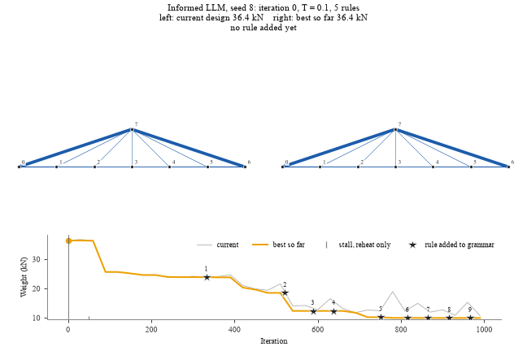
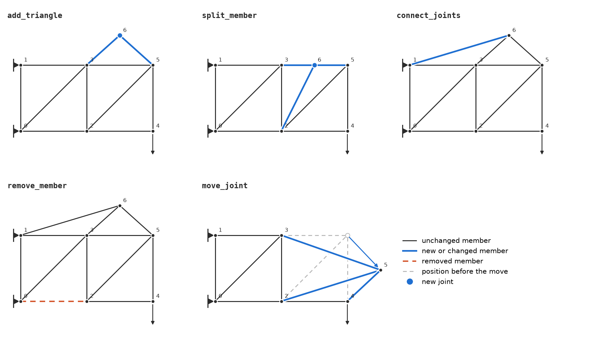

# VLM Design Grammar (`vlmdg`)

The main idea of the project is to use vision language models to grow the grammar during the optimiziation when we are using the existing rules to perform desgin space exploration.  When this optimization stalls (suppose same objective value for 50 iterations), the model receives the current design and, in the informed condition, search diagnostics. It proposes a Python rule. The rule is checked for execution and structural admissibility before joining the grammar. The few questions we want to answer are can VLM suggest new rules that help obtain better solutions, how does random, uninformed, and informed generation of rule impact the search after the stall.

The test problems are inspired by the ten-bar truss of G. M. Reddy and J. Cagan, “Optimally Directed Truss Topology Generation Using Shape Annealing,” *Journal of Mechanical Design* (1995), and by planar deck bridges. The ten-bar problem is widely used in structural optimization benchmark task and thus is used here as well. 

**Best bridge found (informed VLM, seed 8): 36.4 kN start → 10.0 kN.** Left: current design; right: best so far. Stars on the weight trace mark the stalls where the VLM added a rule.



## Directory layout

| Folder | Contents |
|---|---|
| `src/vlmdg/` | The package: command line (`cli.py`), run setup (`runner.py`), the full-study script (`run_all.py`), and the subpackages below |
| `src/vlmdg/design/` | Truss data structure, saving and loading, and plotting |
| `src/vlmdg/fea/` | Finite element analysis (FEA) of trusses and the stress and buckling checks |
| `src/vlmdg/grammar/` | Grammar rules, the five starting rules, the admissibility gate, and duplicate-rule detection |
| `src/vlmdg/optimize/` | Shape annealing, bar sizing, the objective, stall handling for each mode, and search diagnostics |
| `src/vlmdg/problems/` | Test problems: `ten_bar`, `bridge`, and `cantilever` |
| `src/vlmdg/rulegen/` | Rule generation: the VLM prompt, parsing its reply, and running the rule code in a sandbox |
| `src/vlmdg/vlm/` | Model providers: TAMU AI Chat, OpenAI, Anthropic, local, and an offline mock |
| `studies/` | Scripts that run each mode over many seeds, build the rule pool, and summarize the results |
| `tests/` | Automated tests (`python -m pytest`) |
| `docs/` | README figures: the starting rules (with the script that draws them) and the best bridge run |
| `runs/` | Output of runs and studies (generated) |

## Optimization problem

A design $D$ is a planar pin-jointed truss: joints, members, and a cross-sectional area $A_e$ for each member $e$. The search minimizes the structural weight:

$$
\begin{aligned}
\min_{D} \quad & W(D) = \sum_{e} \rho \, A_e \, L_e \\
\text{s.t.} \quad & |\sigma_e| \le \sigma_{\text{allow}} && \text{(axial stress, every member)} \\
& -\sigma_e \le \sigma_{\text{cr},e} = \frac{\pi^2 E \, I_e}{A_e L_e^2}, \quad I_e = \frac{A_e^2}{4\pi} && \text{(Euler buckling, compression members)} \\
& A_{\min} \le A_e \le A_{\max} && \text{(area bounds)} \\
& \det \mathbf{K}(D) \ne 0 && \text{(stable truss)}
\end{aligned}
$$

Here $L_e$ is the member length, $\rho$ the weight density, $E$ Young's modulus, and $\mathbf{K}$ the global stiffness matrix. $I_e$ is the second moment of area of a solid circular section.

The member stresses $\sigma_e$ come from linear finite-element analysis. Grammar rules change the topology and the joint positions. Each candidate is then sized to get its areas, and only after that is it scored. Supports and loaded joints never move. Joints stay inside the design domain, and members respect the spacing and length limits of the problem spec.

Material (aluminium, with values taken from the Reddy & Cagan ten-bar problem): $E = 68.8$ GPa, weight density $\rho = 27$ kN/m³ (so $W$ is in newtons), $\sigma_{\text{allow}} = 172$ MPa, $A_{\min} = 6.45 \times 10^{-5}$ m², $A_{\max} = 0.2$ m².

| Problem | Domain | Supports | Loads | Start design | Extra constraint |
|---|---|---|---|---|---|
| `ten_bar` (default) | 18.2 × 9.1 m (two 9.1 m bays) | Pins at both left joints | 445 kN down at the two bottom free joints | A ten-bar truss with crossed diagonals in both bays | None |
| `bridge` | 24 × 6 m above the deck (six 4 m panels) | Pin at the left end, roller at the right | 100 kN down at each of the five interior deck joints | Deck chord plus a fan from one apex at (12, 4) m (36.4 kN) | Planar: no crossing members and no joint on a member it is not part of |

## Search and modes

The search uses shape annealing: simulated annealing in which each move applies a grammar rule to the current design. A **stall** is declared when the best design has not improved for `--stall-window` iterations; the mode then decides what happens to the grammar, and the search is reheated.

The initial grammar G0 has five rules: `add_triangle`, `split_member`, `connect_joints`, `remove_member`, and `move_joint`. The first four change the topology; `move_joint` changes only the geometry. No rule changes member areas, because the sizing step sets them for every candidate.

**Figure: the five rules of the initial grammar G0.** 



The figure is generated by `python docs/plot_g0_rules.py docs/g0_rules.png`.

| Mode (`--mode`) | What happens at a stall | Role |
|---|---|---|
| `reheat` | Nothing is added; the search only reheats | Baseline: fixed grammar G0 |
| `random` | A random composition of 2–3 base topology rules is added | Control: grammar growth without design knowledge |
| `uninformed` | The LLM sees the current best design (as text and an image) and the rule list, and proposes one rule | Control: LLM rule generation without search context |
| `informed` | Same as `uninformed`, plus search diagnostics: stall index, temperature, active or violated constraints, per-rule utility (proposed/accepted, mean energy change), and recently accepted rules | Treatment |
| `expanded` (`reheat` with `--extra-rules`) | Nothing is added; the grammar starts as G0 plus a pool of rules accepted in earlier `uninformed` and `informed` runs | Control: a larger grammar that stays fixed |

`--max-rule-stalls N` lets only the first N stalls add a rule; later stalls only reset the temperature.

## Setup

Clone the repository and create the environment:

```bash
git clone https://github.com/Niel-77/VLMDG.git
cd VLMDG
conda env create -f environment.yml
conda activate vlmdg
python -m pip install -e '.[dev]'
```

For TAMU calls, you need a TAMU AI Chat API key:

1. Sign in at [chat.tamu.ai](https://chat.tamu.ai).
2. Click your profile (your name) at the bottom left, and open the settings.
3. Open the **Account** tab and create an API key. Copy it; treat it like a password.
4. Copy `.env.example` to `.env` and set `TAMUS_AI_CHAT_API_KEY` to the key.

The model name gets the `protected.` prefix automatically.

For OpenAI calls, you need an OpenAI API key:

1. Sign in at [platform.openai.com](https://platform.openai.com).
2. Open **API keys** in the settings and create a new secret key. Copy it; treat it like a password.
3. In `.env`, set `OPENAI_API_KEY` to the key.

Then use `--provider openai --model gpt-6-luna` in place of `--provider tamu --model gpt-5.6-luna` in the commands below.

## Run the full study

One command runs every mode on both problems for seeds 0–9, builds the rule pool, runs the expanded grammar, and makes the summary tables, plots, and GIFs:

```bash
python -m vlmdg.run_all
```

- Results: `runs/study_<problem>/<mode>/seed<k>/`; analysis: `runs/study_<problem>/analysis/`; progress: `runs/run_all.log`.
- Finished runs are skipped, so running the command again resumes the study. `--fresh` deletes earlier results first.
- A run that hangs (for example on a model call) is restarted once after `--timeout` seconds (default 3600).
- Other options: `--problems bridge`, `--seeds 0-4`, `--workers 5` (parallel runs per mode), `--provider`/`--model`, `--no-gif`, `--runs <folder>`.
- With the TAMU model, the full study took about one hour per five seeds. To check the pipeline offline in a few minutes: `python -m vlmdg.run_all --provider mock --seeds 0-1 --runs runs/test`.

## Run one problem and mode at a time

Run the tests with `python -m pytest`. Every study run uses 1,000 iterations, a 50-iteration stall window, and adds rules at the first 10 stalls at most. One run of each mode on `ten_bar` with seed 0:

```bash
# reheat (baseline)
vlmdg run --problem ten_bar --mode reheat --seed 0 \
    --out runs/study_ten_bar/baseline/seed0 \
    --iterations 1000 --stall-window 50 --max-rule-stalls 10 --max-stalls 1000000 \
    --initial-temperature 0.1 --cooling-rate auto --reheat-fraction 0.5 --snapshot-every 30

# random
vlmdg run --problem ten_bar --mode random --seed 0 \
    --out runs/study_ten_bar/random/seed0 \
    --iterations 1000 --stall-window 50 --max-rule-stalls 10 --max-stalls 1000000 \
    --initial-temperature 0.1 --cooling-rate auto --reheat-fraction 0.5 --snapshot-every 30

# uninformed
vlmdg run --problem ten_bar --mode uninformed --provider tamu --model gpt-5.6-luna --seed 0 \
    --out runs/study_ten_bar/uninformed/seed0 \
    --iterations 1000 --stall-window 50 --max-rule-stalls 10 --max-stalls 1000000 \
    --initial-temperature 0.1 --cooling-rate auto --reheat-fraction 0.5 --snapshot-every 30

# informed
vlmdg run --problem ten_bar --mode informed --provider tamu --model gpt-5.6-luna --seed 0 \
    --out runs/study_ten_bar/informed/seed0 \
    --iterations 1000 --stall-window 50 --max-rule-stalls 10 --max-stalls 1000000 \
    --initial-temperature 0.1 --cooling-rate auto --reheat-fraction 0.5 --snapshot-every 30

# expanded: reheat with the pool of rules accepted in the uninformed and informed runs above
python studies/build_pool.py --problem ten_bar
vlmdg run --problem ten_bar --mode reheat --extra-rules runs/study_ten_bar/rule_pool.json --seed 0 \
    --out runs/study_ten_bar/expanded/seed0 \
    --iterations 1000 --stall-window 50 --max-rule-stalls 10 --max-stalls 1000000 \
    --initial-temperature 0.1 --cooling-rate auto --reheat-fraction 0.5 --snapshot-every 30
```

`--max-stalls 1000000` lets a run go through any number of stalls until the iteration budget is used. To check the pipeline offline, replace `--provider tamu --model gpt-5.6-luna` with `--provider mock`. To optimize the bridge instead, change `ten_bar` to `bridge` everywhere in these commands (in `--problem` and in the paths).

Each run writes its configuration, designs, plots, search history, and rule proposals to its `--out` directory. The `mock` provider is an offline stand-in for the LLM that returns a fixed rule without an API call; use it to check that the pipeline works.

Main options (see `vlmdg run --help` for the rest):

- `--problem`: `ten_bar` (default), `bridge`, or `cantilever`.
- `--mode`: `reheat`, `random`, `uninformed`, or `informed` (see Search and modes).
- `--out`: the run's output directory.
- `--seed`, `--iterations`, `--stall-window`: random seed, iteration budget, and stall length.

The `studies/` scripts run the comparison of modes over many seeds and analyze the results.

After the runs, summarize everything in `runs/study_ten_bar/`:

```bash
python studies/analyze.py --problem ten_bar
```

This writes to `runs/study_ten_bar/analysis/`: a table of the best weights (`summary.md`), the convergence plot of all modes together (`convergence.png` and `.pdf`; each line is the mean over seeds), the best design of each mode (`best_design_<mode>.png`), and one GIF per mode showing how the design changes during the run (`evolution_<mode>_seed<k>.gif`, for the seed with the median result). The GIFs use the designs saved by `--snapshot-every 30`; add `--no-gif` to skip them. For the bridge, use `--problem bridge`.
